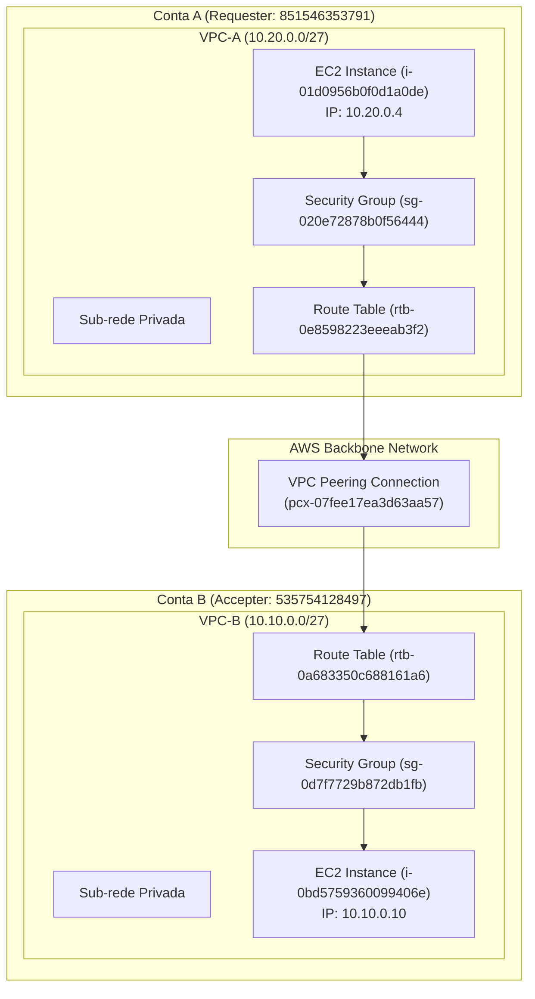

## Integrante
* **Luiz Felipe Campos da Silva** — Matrícula: `22310854`
* # VPC Peering Inter-Contas AWS & Laboratório de Computação em Nuvem

## Descrição do Projeto
Este repositório documenta a implementação de uma arquitetura de rede privada utilizando **VPC Peering entre duas contas distintas da AWS** (Conta A: Requester e Conta B: Accepter), permitindo comunicação segura e de baixa latência entre instâncias EC2 sem tráfego exposto à Internet.

---

## 📐 Diagrama da Arquitetura

---

## Infraestrutura & Mapeamento de Portas

### Tabela de Ativos e Mapeamento

| Componente | Conta A (Requester) | Conta B (Accepter) |
| :--- | :--- | :--- |
| **Account ID** | `851546353791` | `535754128497` |
| **VPC ID** | `vpc-066616038bb97536b` | `vpc-078253e2542ea78a4` |
| **Bloco CIDR** | `10.20.0.0/27` | `10.10.0.0/27` |
| **EC2 Instance ID** | `i-01d0956b0f0d1a0de` | `i-0bd5759360099406e` |
| **IP Privado** | `10.20.0.4` | `10.10.0.10` |
| **Route Table ID** | `rtb-0e8598223eeeab3f2` | `rtb-0a683350c688161a6` |
| **Security Group** | `sg-020e72878b0f56444` | `sg-0d7f7729b872db1fb` |

### Regras de Firewall (Security Groups / Portas)

* **VPC-A Security Group (`sg-020e72878b0f56444`):**
  * `ICMP (All)` — Origem: `10.10.0.0/27` (Permite pacotes ICMP vindos da VPC-B)
  * `TCP (Porta 22 / SSH)` — Origem: `10.10.0.0/27`
* **VPC-B Security Group (`sg-0d7f7729b872db1fb`):**
  * `ICMP (All)` — Origem: `10.20.0.0/27` (Permite pacotes ICMP vindos da VPC-A)

---

## Registro de Recursos e Custos Estimados

| Recurso | Quantidade / Configuração | Custo Estimado (Free Tier / Learner Lab) |
| :--- | :--- | :--- |
| **Instâncias EC2** | 2x `t2.micro` / `t3.micro` | Gratuito (coberto pelo AWS Free Tier / AWS Academy) |
| **VPC Peering Connection** | 1 conexão (`pcx-07fee17ea3d63aa57`) | Sem custo por hora de conexão |
| **Transferência de Dados** | Tráfego intra-região (`us-east-1`) via Peering | $0.01 / GB em cada direção (descontado do saldo do laboratório) |

---

## Dificuldades Encontradas & Soluções

1. **Roteamento Bidirecional Pendente:**
   * *Desafio:* O peering foi estabelecido com status `Active`, mas os pings não alcançavam a instância de destino.
   * *Causa:* Conexões de peering não propagam rotas automaticamente.
   * *Solução:* Adição manual das rotas apontando os CIDRs remotos (`10.10.0.0/27` e `10.20.0.0/27`) para o alvo `pcx-07fee17ea3d63aa57` nas Route Tables de ambas as contas.
2. **Restrição Estrita de Security Groups:**
   * *Desafio:* Garantir que a comunicação funcionasse sem expor a rede para `0.0.0.0/0`.
   * *Solução:* Criação de regras de entrada (*Inbound Rules*) direcionadas exclusivamente aos blocos CIDR exatos da VPC oposta.
3. **Não Transitividade do VPC Peering:**
   * *Compreensão Teórica:* Identificou-se que o modelo `A ↔ B ↔ C` não repassa tráfego de `A` para `C`, necessitando de conexões diretas ou uso do *AWS Transit Gateway*.

---

## Evidências da Persistência e Validação

1. **Identificador da Conexão Peering:** `pcx-07fee17ea3d63aa57` (Status: `Active`).
2. **Atualização da Tabela de Rotas VPC-A:** `rtb-0e8598223eeeab3f2` com destino `10.10.0.0/27` e alvo `pcx-07fee17ea3d63aa57`.
3. **Atualização da Tabela de Rotas VPC-B:** `rtb-0a683350c688161a6` com destino `10.20.0.0/27` e alvo `pcx-07fee17ea3d63aa57`.
4. **Validação nos Security Groups:** Liberação de ICMP bidirecional restrita aos blocos de IP correspondentes.

---

